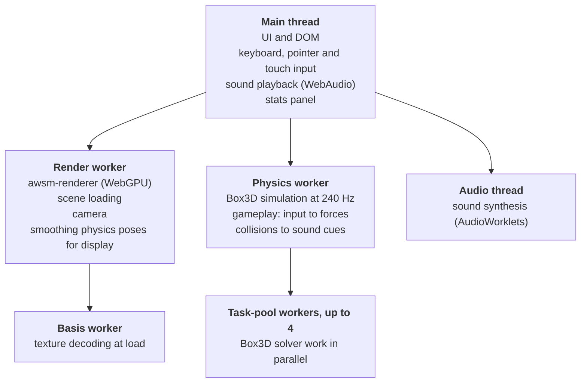
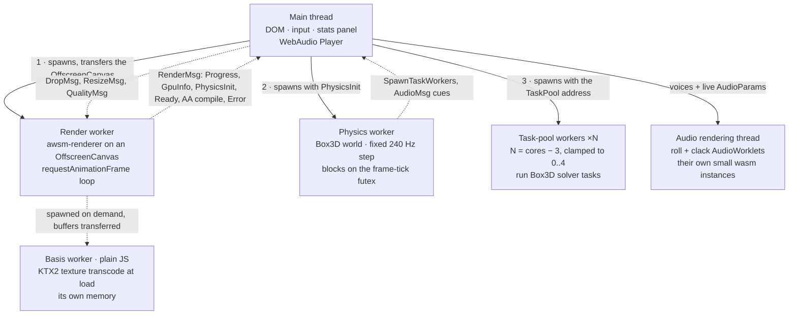
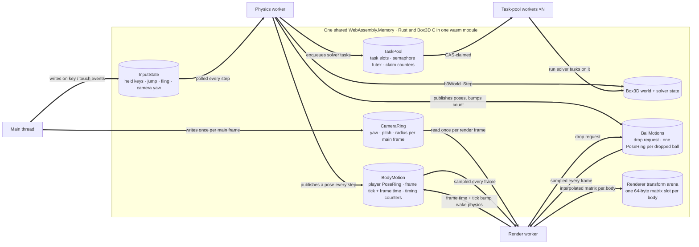

# AWSM Template
## Spatial audio and Multithreaded physics w/ Box3D

## **▶ [Live site](https://awsm.fun/experiments/box3d-multithreaded)** 
_the same build also deploys to GitHub Pages on every merge to `main`._

----
A copyable **template** from the [**Awsm**](https://awsm.fun) project: it
*plays* a scene authored in the [scene editor](https://scene.awsm.fun),
rendered with [`awsm-renderer`](https://crates.io/crates/awsm-renderer), with
[Box3D](https://github.com/erincatto/box3d) physics (Erin Catto's C engine,
**compiled into the same wasm module**) and spatial sound authored in the
[audio editor](https://audio.awsm.fun) (played by
[`awsm-audio-player`](https://crates.io/crates/awsm-audio-player)) — running
across **three wasm threads plus a physics task pool**, all over one shared
`WebAssembly.Memory`. Box3D's internal parallelism and SIMD are real here:
its solver fans out across web workers through a futex-based task pool, and
its SSE2 math runs on **wasm simd128**.

The shipped scene is a **red** ball on a felt table with wooden rails. It drops
in and bounces; you roll it around and make it hop, and it makes 3D sound — a
rolling rumble that tracks its speed, plus a knock when it hits a rail and a thud
when it lands. **Click anywhere on the table to drop another (silver) ball
there** — every drop, bounce, and ball-on-ball clack cues a sound too, and the
top-right panel shows what each thread is doing while it happens. The point
isn't the gameplay — it's the skeleton: editor export → player loader →
renderer, **physics colliders derived from the scene's own collider nodes**,
with physics on its own threads feeding transforms through shared memory and
audio cues back to the main thread.

## Threading at a glance

### What runs where



Arrows point from a thread to the threads that work on its behalf.

### In detail

**Who spawns whom, and what crosses by message.** Main spawns every Rust
worker (the physics worker blocks on a futex for its whole life, so it asks
main to spawn its task pool). Dotted arrows are `postMessage` — cold paths
only, nothing per frame.



**What is shared where.** Main, render, physics and the task pool are the
*same* wasm module attached to *one* `WebAssembly.Memory`, so a plain Rust
struct is visible to all of them at the same address. Thick arrows are
shared-memory reads/writes (atomics, no messages); each block is allocated
once and leaked for the session, and only its address is ever posted.



| Shared block | Allocated by | Written by | Read by | Synchronization |
|---|---|---|---|---|
| `InputState` | main | main | physics, once per step | relaxed atomics; seq counters edge-detect jumps / flings; a pressed-since-last-step latch so a quick tap is never lost |
| `CameraRing` | main | main, once per main frame the camera changed | render, every frame | per-slot seqlock; render takes the newest slot at least half a frame old |
| `BodyMotion` — pose ring | render | physics, every step | render, every frame | per-slot seqlock tagged with its step and due time |
| `BodyMotion` — frame tick + frame time | render | render, at the start of every frame | physics blocks on the tick, steps to the time | futex (`memory.atomic.wait32` / `notify`); time stored before the tick (Release / Acquire) |
| `BodyMotion` — timing counters | render | render + physics | main's 1 Hz stats sampler | relaxed atomics |
| `BodyMotion` — Stats detail bits | main | main, when a Stats group is toggled | render + physics, once per frame | relaxed atomic |
| `BodyMotion` — step-phase totals | render | physics, ~4×/s while asked | main's 1 Hz stats sampler | seqlock |
| `BallMotions` — drop request | render | render (from main's `DropMsg`) | physics, once per step | seq counter, Release / Acquire |
| `BallMotions` — per-ball pose rings + count | render | physics | render, every frame; main (ball count) | seqlock per slot; count is Release / Acquire |
| `TaskPool` | physics | physics enqueues; pool workers and physics claim | pool workers; main (claim counters for stats) | CAS on slot status + futex counting semaphore |
| Box3D world | physics | physics and pool workers, only inside `b3World_Step` | same | Box3D's own task partitioning |
| Transform arena | render (the renderer) | render only | render (GPU upload) | none needed — single thread |

Not shared: the **audio worklets** run on the browser's audio rendering
thread as separate small wasm instances, driven only through WebAudio
params from main; the **Basis worker** is a plain JS worker with its own
memory. Neither attaches to the shared `WebAssembly.Memory`. Details for all
of this are in [The threads](#the-threads) below.

## Run it

```sh
git submodule update --init   # vendor/box3d (task dev runs this too)
task dev                      # trunk serve on http://127.0.0.1:9000 (COOP/COEP enabled)
```

Besides the usual Rust-wasm toolchain (`task`, `trunk`, nightly via
`rust-toolchain.toml`), building needs a **wasm-capable clang** for the Box3D C
sources: Apple's clang has no wasm backend, so on macOS `brew install llvm`
(build + Taskfile probe the Homebrew path automatically, or point
`CC_wasm32_unknown_unknown` at one). Linux distro clang works as-is.

Open it in a browser with **WebGPU** + **`SharedArrayBuffer`** (recent
Chrome/Edge).

**Controls:**

| Input | Action |
|---|---|
| **W/A/S/D** or **arrow keys** | roll the red ball |
| **Space** | jump |
| **click** | drop a silver ball at the clicked table spot (up to 200) |

The camera is **locked** to a fixed head-on pose so the view lines up with the
spatial-audio stage (see [Audio](#audio)); flip `CAMERA_LOCKED` in
`packages/frontend/src/render_thread.rs` to restore mouse orbit / pan / zoom.

Sound starts on your **first key or click** (browser autoplay policy requires a
user gesture). See [Audio](#audio) for the full runtime control surface.

Other tasks: `task build` (production build into `dist/`), `task check`
(threaded `cargo check`, no serve), `task lint` (clippy), `task fmt` (format),
`task clean`; `cargo test -p box3d-sys` runs the native Box3D + FFI
struct-layout tests. CI (`.github/workflows/ci.yml`) runs `cargo fmt --check`, the
`box3d-sys` host tests, and `task lint` on every push and PR; on merge to
`main`, `.github/workflows/deploy.yml` builds and publishes `dist/` to GitHub
Pages; the same build is double-hosted at the
[live site](https://awsm.fun/experiments/box3d-multithreaded).

## The threads

A single wasm bundle serves every role; the active role is chosen at
runtime (the `wasm-bindgen-rayon` pattern — `packages/frontend/src/lib.rs`).

| Thread | File | Responsibility |
|---|---|---|
| **Main** | `packages/frontend/src/main_thread.rs` | Owns the DOM (built with **Dominator**) + keyboard input, and the **WebAudio player** (`packages/frontend/src/audio.rs`). Spawns the render worker, the physics worker, and (on the physics worker's request) the task-pool workers. |
| **Render** | `packages/frontend/src/render_thread.rs` | Hosts **awsm-renderer** on an `OffscreenCanvas`, loads `scene.toml` via `load_scene_for_player`, derives the collider list (`derive_physics`), and every frame publishes its frame time (pacing physics), **interpolates** each body's pose at the previous frame's time and writes it into the transform arena. |
| **Physics** | `packages/frontend/src/physics_thread.rs` | Runs a **Box3D** world built from the scene's colliders (static table + walls, dynamic ball) at a **fixed step** (`SIM_HZ`, 240 Hz default), catching up to **the render thread's published frame time** each frame, polls input from shared memory, publishes each step’s pose into shared pose rings, and emits audio cues from contact events. |
| **Task pool ×N** | `packages/frontend/src/physics_tasks.rs` | `hardware_concurrency - 3` (≤4) workers parked on a futex semaphore. Box3D's `b3ParallelFor` enqueues solver tasks into a shared slot array; the pool (and the stepping thread itself) CAS-claim and execute them. Pure compute — no JS, no messages. |

### Data flow

```
  main ──(spawn, OffscreenCanvas transferred)──▶ render
  render ──(PhysicsInit: BodyMotion + InputState addrs + collider list)──▶ main ──▶ physics
  physics ──(SpawnTaskWorkers)─▶ main ──(spawn ×N)─▶ task pool
  main ──(held keys / jumps)───────────────────▶ physics   ← InputState, shared mem
  main ──(camera, once per main frame)─────────▶ render    ← CameraRing, shared mem
  render ──(frame time + tick, every frame)────▶ physics   ← BodyMotion, shared mem
  physics ══(solver tasks, inside every step)══▶ task pool ← TaskPool, shared mem futex
  physics ──(PoseRing poses + times, every step)▶ render ← shared mem, NO postMessage
  physics ──(AudioMsg: roll / wall-hit / land)─▶ main ──▶ WebAudio player
```

Only the cold paths are `postMessage` (`packages/frontend/src/protocol.rs`); everything per-frame is
**shared memory**. Physics publishes every fixed step's pose, stamped with the
time that step is due, into a small **pose ring** per body (`PoseRing`,
seqlock'd slots tagged with their step); the render thread interpolates
between the two steps around its display time and writes the result into the
renderer's transform arena. Keyboard input flows the same way — main writes
held keys / jumps into an `InputState` block the physics worker polls — and so
does the camera (`CameraRing`, below). No copy, no per-frame messaging.

**Frame pacing: Fix Your Timestep, across two threads.** The standard loop
([Fix Your Timestep](https://gafferongames.com/post/fix_your_timestep/),
MainLoop.js) reads the clock once per frame, adds the elapsed time to an
accumulator, runs as many fixed steps as it pays for, and draws
`lerp(previous, current, accumulator / step)`. Here the steps and the drawing
are on different threads, so that one clock reading has to travel:

1. At the **start** of each frame, the render thread publishes the frame's
   `requestAnimationFrame` timestamp `T` (absolute, `performance.timeOrigin +
   t`, in wrapping µs — the threads have different time origins) and bumps a
   frame tick. Starting the burst then, not after the frame's own work, gives
   physics the whole frame period.
2. The physics worker, blocked on that tick (`memory.atomic.wait`), adds
   `T − T_prev` to its accumulator and runs as many fixed `1/SIM_HZ` steps as
   that pays for (capped at 100 ms of catch-up, beyond which the backlog is
   dropped and the world slows instead of spiralling). Every step's pose is
   stamped with the time it is due, `T − accumulator`, computed from the f64
   accumulator. Physics never reads its own clock for this: at wake-up it
   would carry the render thread's CPU time and the futex wake latency, which
   wobble from frame to frame and used to turn a steady 4 steps per 60 Hz
   frame into 3/4/5.
3. The next frame draws the world at `D = T − one step` — inside the pair of
   steps that burst left, so it is exactly the textbook
   `lerp(previous, current, alpha)`, one frame later because the burst ran
   alongside the frame in between. `D` is fixed before the next burst starts,
   so steps written meanwhile can't move what this frame shows. If the burst
   isn't done in time, the newest step is older than `D`: the frame holds it
   (no extrapolation) and counts as a **late frame** in the Stats panel.

Latency is therefore one frame plus at most one step (4.2 ms at 240 Hz), and
it does not move. An earlier version instead let physics read its own clock
and gave the renderer an adaptive "display cursor" (a lag of 2–24 steps
behind the newest pose) to hide the resulting 3/4/5-step bursts; it varied
the playback speed while correcting and kept extra latency for seconds after
a hiccup. Two consequences of pipelining remain and are accepted: a dropped
(or variable-refresh) frame shows as a stall followed by a double step,
because frame `k + 1` shows the interval that ended at frame `k`; and while
the tab is hidden, rAF stops, so the simulation pauses. Pose is published as
position + quaternion (not a baked matrix) so the reader can `lerp`
translation and `slerp` rotation correctly.

**The camera: one frame of input per drawn frame.** The main thread owns
the orbit camera (it has the pointer events): it applies every drag and wheel
event, fans the yaw out to physics (camera-relative W/A/S/D) and the audio
listener, and in its own `requestAnimationFrame` callback writes yaw / pitch /
radius into a 4-slot `CameraRing`, stamped with that frame's time. Pointer
input is delivered once per main-thread frame, but the render worker runs its
own frame loop: reading "the latest camera" would race the two, and a render
frame that starts just before main writes would see no movement while the
next sees two frames' worth — the orbit judders 0/2. So the render worker
takes the newest slot written at least half a frame before its own frame
time: main's previous frame. That is exactly one frame of input per drawn
frame, one frame of camera latency, and no race. The camera never goes
through the fixed-step simulation, so it isn't interpolated either.

**Forking note — interpolation vs extrapolation.** This template
*interpolates* (displays slightly behind the newest step) because prediction
overshoots on discontinuities, and this scene is all bounces. A twitch-genre
fork may prefer *extrapolation*: draw at the frame's own time instead of one
frame back, and let `sample_at` evaluate the newest pose pair with
`alpha > 1` (an unclamped lerp/slerp is already a first-order predictor).
Skip prediction across a `publish_snap` (teleports read as huge velocities
for one frame), and for better prediction have physics publish velocity in
each `PoseSlot`. At 240 Hz the stakes are small either way.

**One rate knob: `SIM_HZ`.** The step rate lives in a single `protocol::SIM_HZ`
(default **240 Hz**), which both threads derive their timestep from. It's a genuine
one-number tuning knob because nothing else is written in "ticks": physical
quantities (velocities, gravity, damping, `MOVE_ACCEL` as an acceleration) are
`dt`-invariant, and the few tick counts (`ROLL_EVERY`, `IMPACT_COOLDOWN`,
`MAX_SUBSTEPS`) are *derived* from `SIM_HZ`, so the feel is identical at any rate.
Raising it lowers the interpolation part of the latency (at most one step: ≈4 ms at
240, ≈17 ms at 60) and tightens collisions, for a linear CPU cost (~0.2 ms per
step here). The rule when extending: **express any new per-step force per second
and multiply by the step `dt`** — never bake the rate into a constant.

Audio lives on the **main** thread because WebAudio is main-thread-only. Physics
owns the ball's motion + contacts, so it decides *when* sounds fire and how loud,
posting `AudioMsg`s that `packages/frontend/src/audio.rs` turns into live WebAudio parameter
changes.

### Colliders from the scene

`awsm-scene` can author **collider nodes** (box / sphere / capsule / …) right in
the scene. `render_thread::derive_physics` walks the loaded tree, composes each
collider's world transform by hand (parent × local), **folds the accumulated
per-axis scale into the shape extents** (a physics collider has no scale of its
own — its placement is a rotation + translation), and ships the list to physics
in `PhysicsInit`. The node named **`Ball`** becomes the dynamic body; everything
else is static. On the Box3D side a box becomes a convex hull
(`b3MakeBoxHull`), sphere/capsule are primitives, and cylinder/cone map to
Box3D's generated hulls. Move impulses are scaled by the ball's mass so the
feel is independent of the authored ball size, and a fall-through safety net +
bullet CCD keep the ball on the low-railed table.

### Box3D — C physics inside the same wasm module

Box3D is vendored as a **git submodule** (`vendor/box3d`) and compiled by
`packages/box3d-sys/build.rs` (the `cc` crate + a wasm-capable clang) **into the same
wasm module as the Rust** — one shared memory, no bridge, no copies, no
Emscripten. What makes that work (all in `packages/box3d-sys/` + BOX3D.md):

- a ~5-file **shim libc** (`shim/include/`) plus stb_sprintf-backed
  `printf`/`snprintf` and a real `qsort` (`shim/wasm_libc.c`) — there is no
  sysroot on `wasm32-unknown-unknown`;
- Rust-side symbols (`packages/box3d-sys/src/wasm_shim.rs`): an allocator over the Rust
  global allocator, `libm` transcendentals, spinlock mutexes, and trap-loud
  stubs for the pthread scheduler that never runs here (Box3D's task system is
  pluggable — this template supplies its own, see below);
- every C object built with `-matomics -mbulk-memory` so wasm-ld accepts it
  into the `--shared-memory` module, and `-ffp-contract=off` for Box3D's
  cross-platform determinism;
- **SIMD**: `-msimd128 -DB3_CPU_WASM` routes Box3D onto its SSE2 solver path,
  with `shim/include/emmintrin.h` mapping those intrinsics onto **wasm
  simd128** — measured ~20% faster stepping than scalar, with **bit-identical**
  results (`BOX3D_WASM_SCALAR=1 task dev` builds the scalar variant for A/B);
- **the task pool** (`packages/frontend/src/physics_tasks.rs`): Box3D's `b3WorldDef` accepts
  user `enqueueTask`/`finishTask` callbacks, so its internal parallelism runs
  on our web workers — shared slot array + futex counting semaphore, the
  waiting thread help-executes (same contract as Box3D's own scheduler). The
  sim is **deterministic across worker counts and SIMD/scalar** — same seeds,
  same pose bits.

### Click-to-drop balls

A click drops a silver ball at the clicked spot, exercising the whole stack at
runtime: **main** turns the click into NDC and posts it to **render** (only it
knows the camera), which unprojects onto the tabletop and files a drop request
in the shared `BallMotions` block; **physics** — which has no event loop, it
blocks on the frame-tick futex — polls that request each step, creates the
body, and publishes its pose slot; render then mints the visual as a **mesh
duplicate** of the ball (`duplicate_mesh_with_transform` — shared GPU geometry
+ material), driven through its own transform-arena slot like every other
body. The **player ball wears a cloned, red-tinted material** (swapped in
up-front so duplicates inherit the original silver). Dropped balls are
deliberately cheaper than the player: no CCD, sleep allowed. Impact audio for
*all* balls comes from Box3D's **hit events** (contact point + approach speed
→ position + intensity), so every drop thud, rail knock, and ball-on-ball
clack is audible; the cap is 200 balls (see the rstar note in BOX3D.md).

### Loading screen + worker stats

The loading overlay lives in the static `packages/frontend/index.html` (visible while the wasm
bundle itself downloads/compiles — "loading code…"), then streams every load
phase as it happens: the render worker relays `RenderMsg::Progress` lines for
device creation, the scene fetch, each `awsm-renderer` loader phase
(materials/meshes/textures/pipelines), and the GPU commit stats, and main adds
its own milestones (audio, worker spawns).

The top-right **Stats** panel (bottom-left **Stats** button;
`packages/frontend/src/stats.rs`) has one collapsible group per thread, so
every number sits under the thread that spent it, with its unit and its basis
(`/ frame`, `/ step`, `/ s`):

- **frame budget**: the refresh period (`16.7 ms (60 Hz) · headroom 9.5 ms`,
  headroom being the budget less the largest lane; `over by …` and red when
  that is negative) and, expanded, one lane per thread plus the GPU, each its
  time per drawn frame against the budget: GPU, renderer, physics (its step
  time divided by the frames drawn; the pool threads run inside that step, so
  they have no lane of their own) and page. CPU and GPU work run in parallel,
  so each must fit the budget on its own; they do not add up, except when the
  CPU waits on the GPU, which shows as missed frames. The last row, renderer
  CPU plus GPU per frame, is a latency figure for reference only.
- **display**: the refresh rate of the browser's frame clock, measured by a
  `requestAnimationFrame` loop on the (light) main thread since no web API
  reports it (`packages/frontend/src/refresh.rs`); frames presented per
  second; and **missed frames**, refreshes that went by with no new frame
  (the render thread sums the time between its presented frames,
  `BodyMotion::frame_span_us`, and a span of `S` ms at refresh period `P`
  should hold `S / P` frames). Nonzero means the renderer is not keeping up
  with the display: lower the resolution or the anti-aliasing.
- **GPU**: GPU time per frame from timestamp queries (`n/a` without
  `timestamp-query`); expanded, one row per pass, slowest first. On Apple
  GPUs passes overlap, so the rows add up to more than the frame: expected.
- **renderer (render worker)**: the render thread's CPU time per frame;
  expanded, its four phases (read app state + interpolate, set
  camera, update transforms, render) with awsm-renderer's CPU scopes nested
  under render, grouped by `profiling::cpu_scope_kind` into **prepare**
  (uploads, bind groups, … before the first pass), **passes**, **submit**
  and **hooks** (when any ran), each listing its scopes slowest first (those
  under 1 µs folded into one line), then **outside the scopes**: the rest of
  render.
- **physics (Box3D, physics worker + N pool threads)**: the physics thread's
  CPU time per fixed step (including waiting on the pool inside the step);
  expanded, steps/s, **late frames** (frames drawn before physics had
  finished the burst they show; red, on the row and the header, once it
  persists for three seconds), the step's phases (input + ball drops, Box3D
  step, contacts + sound cues, publish poses), how the solver's task time
  split between the physics thread and the pool, and the balls dropped.
- **page (main thread)**: this thread's own per-frame work (its camera frame
  loop and the sound cues it plays).

The panel's `what do these mean?` button opens the **About** modal (bottom
centre) on its **Stats** tab, which explains every group and row in plain
words; its **About** tab has the controls and a short tour. Both are in
`packages/frontend/src/about.rs`.

Groups start collapsed and remember their state (`awsm_box3d_mt_stats_open_<id>`;
`?reset` clears it). Headlines are counters the threads keep in shared
memory anyway, sampled 1×/s by main: no messages, nothing extra on a hot
path. Expanding a group is what turns on its breakdown: main sets a bit in
`BodyMotion`, and only then does the render thread time its phases and turn
on awsm-renderer's CPU scopes (`SubFrame` on every frame while open, `Off`
whenever collapsed; the scope names and totals come back as a
`RenderMsg::Timings` ~4×/s), or the physics thread time its step phases.

## The threaded build profile (why it's different)

A normal wasm build has a private, non-shared linear memory — workers can't share
state through it. Three pieces together produce a bundle that imports one
**shared** memory all threads attach to:

1. **`rust-toolchain.toml`** — nightly + `rust-src` (needed for `-Z build-std`).
2. **RUSTFLAGS + build-std** (`Taskfile.yml`): `+atomics,+bulk-memory,+simd128`,
   `--shared-memory --import-memory`, the wasm-bindgen thread-transform exports,
   and `-Z build-std=std,panic_abort` (recompiles `std` with atomics).
3. **COOP/COEP headers** on serve (`packages/frontend/Trunk.toml`): `Cross-Origin-Opener-Policy:
   same-origin` + `Cross-Origin-Embedder-Policy: require-corp`. Without them
   `crossOriginIsolated` is false and `SharedArrayBuffer` is unavailable. **Any
   production host serving this build must send the same two headers.**

The Box3D **C objects** must match: `packages/box3d-sys/build.rs` compiles them with
`-matomics -mbulk-memory -mmutable-globals` (wasm-ld refuses objects without
atomics in a `--shared-memory` link) — this is why the build needs a
wasm-capable clang. `task preflight` (a dependency of dev/build/check/lint)
checks the submodule + clang up front with an actionable error.

Each worker attaches to the shared memory via the bootstrap in
`packages/frontend/src/bootstrap.rs`: the spawner posts `{ wasm_module, memory }`, and the worker
calls `init({ module_or_path: wasm_module, memory })`.

**Dev builds optimize dependencies.** `Cargo.toml` sets
`[profile.dev.package."*"] opt-level = 3`, so the renderer / audio crates
are compiled optimized even in `task dev`, while our own crate stays at
`opt-level = 0` for fast, debuggable incremental rebuilds. This matters: at
`opt-level = 0` the audio player's per-impact WebAudio graph build runs ~30–60 ms
on the main thread (which handles input), so unoptimized you feel control lag when
the ball hits rails repeatedly; optimized it's a few ms. The one-time cost is a
slower *first* compile.

## Audio

The SFX are an `awsm-audio` export under `media/audio/` (`project.toml` + the
rolling-sound `.wasm` worklet). `packages/frontend/src/audio.rs` fetches them same-origin and drives
them from the physics thread's `AudioMsg`s. The three sounds are **synthesized
live** — the `.wav` bounces in the export are unused at runtime, so the only asset
actually fetched is the worklet `.wasm`. (That worklet's Rust source — the DSP for
the rolling rumble — is in `packages/audio-worklet-roll/`, compiled to the shipped `.wasm`
via the [audio editor](https://audio.awsm.fun)'s worklet toolchain.)

It uses **one `awsm-audio-player` `Player`** — a single `AudioContext` + master bus
mixing many concurrent voices (the `Player` mixer model):

- The **roll** is a sustaining DSP-worklet rumble — the player's persistent
  `play()` instance (looping), so impacts never cut it. Its loudness + timbre + 3D
  position are nudged continuously with `set_param_live`.
- **wall-hit** and **land** are **one-shots** fired as independent voices
  (`play_voice_with`). A voice doesn't stop the roll or each other, and its
  per-trigger statics (intensity → gain, hardness → filter cutoff, table position
  → stage panner) are baked in as build-time **overrides** so the sound is correct
  from its first sample. A spent one-shot self-decays to silence but its source
  nodes (oscillators) keep running, so `packages/frontend/src/audio.rs` **frees each voice** once its
  tail finishes (`stop_voice`, ~0.6 s) — otherwise the idle oscillators pile up
  into a constant hum; a `max_voices` cap is the backstop.

Everything is spatialized (a WebAudio `PannerNode` per sound), but **not** against
the literal camera. From the far-back, tilted-down camera the whole table subtends
too narrow an angle to pan convincingly, so the listener sits at the origin of a
dedicated **audio stage** and the ball's position *on the table* is remapped onto
it — x → hard left/right, z → near/far — filling the stereo field rail-to-rail.
See `stage_pos` in `packages/frontend/src/audio.rs`.

**Runtime control surface** — what the game drives (the roll's columns live via
`set_param_live`; the impacts' as `play_voice_with` overrides at trigger time):

| Sound | Node (label) | Param | Driven by |
|---|---|---|---|
| roll | worklet | `speed` | normalized roll speed `0..1` (impact density + ring length) |
| roll | `roll_LEVEL` | `gain` | roll speed (`0` ⇒ silent at rest) |
| roll | `roll_PANNER` | `positionX/Y/Z` | ball position → audio stage |
| wall-hit | `hit_LEVEL` | `gain` | impact intensity `0..1` (from approach speed) |
| wall-hit | `hit_FILTER` | `frequency` | impact intensity (harder ⇒ brighter) |
| wall-hit | `hit_PANNER` | `positionX/Y/Z` | impact position → audio stage |
| land | `land_LEVEL` | `gain` | landing intensity `0..1` (from drop speed) |
| land | `land_FILTER` | `frequency` | landing intensity |
| land | `land_PANNER` | `positionX/Y/Z` | landing position → audio stage |

The control nodes are resolved by label/kind at load, so you can re-export the
audio project and the wiring still finds them. Every other DSP knob (the
worklet's `roughness` / `body_hz` / `brightness`, the impact mode tunings, …)
keeps its authored value — tweak those in the [audio editor](https://audio.awsm.fun).

**Gameplay → sound mapping** lives in `packages/frontend/src/physics_thread.rs`: roll speed is the
ball's grounded horizontal speed; impacts are classified from Box3D's begin-touch
contact events (each shape carries a floor/wall role in its user data) with
intensity from the pre-step approach speed, debounced by a speed gate + cooldown
so shoving the ball against a rail doesn't machine-gun the knock. The listener is **static** at the
audio-stage origin (not the camera); the camera is locked to match, so what you
hear lines up with what you see.

> **Note — shared memory + WebAudio:** the threaded build backs every wasm typed
> array with a `SharedArrayBuffer`, which the WebAudio spec rejects for channel
> copies (`copyToChannel` "must not be shared"). `awsm-audio-player` **2.5** copies
> through a private buffer internally, so the noise-bearing impacts just work — no
> JS shim needed. 2.5's single-context multi-voice mixer (`play_voice_with`),
> trigger-time param overrides, and live listener are what let this template run
> everything on one `Player` / one `AudioContext`.

## Swapping in your own scene

1. Export a player bundle from the [scene editor](https://scene.awsm.fun) (a `scene.toml` plus any asset bins),
   and optionally a project from the [audio editor](https://audio.awsm.fun).
2. Drop them into `media/` — the scene export as `media/bundle/` (`scene.toml`
   + `assets/`), the audio project as `media/audio/`. That layout is exactly
   what gets served: the `copy-dir` links in `packages/frontend/index.html`
   put it in `dist/` same-origin (COEP blocks cross-origin fetches), and
   `task dev`'s side media server serves `media/` as-is. External scene
   assets go into the `assets` `HashMap` passed to `load_scene_for_player`.
3. Author **collider nodes** in your scene for anything physical. They're derived
   automatically (`render_thread::derive_physics`) — the node named `Ball` is the
   dynamic body; rename/extend that convention as needed and adjust the camera
   framing.
4. In `packages/frontend/src/physics_thread.rs`, tune the materials / impulses / impact mapping; in
   `packages/frontend/src/audio.rs`, point the voices at your own sample names + control-node labels.

## Dependencies

Physics is **[Box3D](https://github.com/erincatto/box3d)** (MIT), vendored as a
git submodule at `vendor/box3d` and built by the local `packages/box3d-sys` crate — see
[Box3D — C physics inside the same wasm module](#box3d--c-physics-inside-the-same-wasm-module)
and `BOX3D.md` for the integration reference.

All Rust crates are from **crates.io** — `awsm-renderer` family `0.11`,
`awsm-audio` family `2.5`, `dominator` / `futures-signals`, `glam` `0.32`,
`libm` (the wasm libc shim's transcendentals) — with **one** exception:
`dominator` is redirected via `[patch.crates-io]` to an upstream git rev. The
published `dominator 0.5.38` does not compile under `web_sys_unstable_apis` (the
cfg WebGPU needs flips mouse-coord types to `f64`); the patch is the same one the
awsm-renderer repo uses, and can be dropped once a fixed dominator is released.
